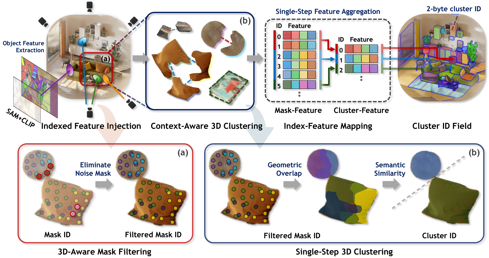

<div align="center">

<h1>[CVPR 2026] LightSplat: Fast and Memory-Efficient<br>Open-Vocabulary 3D Scene Understanding in Five Seconds</h1>

<p>
  <a href="https://devappendcbangj.github.io/"><strong>Jaehun Bang</strong></a><sup>1</sup> ·
  <a href="mailto:jh4011@postech.ac.kr"><strong>Jinhyeok Kim</strong></a><sup>2*</sup> ·
  <a href="mailto:mzkim@unist.ac.kr"><strong>Minji Kim</strong></a><sup>1</sup> ·
  <a href="mailto:sypsss@unist.ac.kr"><strong>Seungheon Jeong</strong></a><sup>1</sup> ·
  <a href="mailto:kyungdon@unist.ac.kr"><strong>Kyungdon Joo</strong></a><sup>1†</sup><br>
  <sup>1</sup>AIGS, UNIST &nbsp;·&nbsp; <sup>2</sup>GSAI, POSTECH<br>
  <sup>*</sup>Work done while at UNIST &nbsp;·&nbsp; <sup>†</sup>Corresponding author
</p>

<p>
  <a href="https://openaccess.thecvf.com/content/CVPR2026/html/Bang_LightSplat_Fast_and_Memory-Efficient_Open-Vocabulary_3D_Scene_Understanding_in_Five_CVPR_2026_paper.html"></a>
  <a href="https://arxiv.org/abs/2603.24146"></a>
  <a href="https://vision3d-lab.github.io/lightsplat/"></a>
  <a href="https://github.com/vision3d-lab/DL3DV-OVS"></a>
  <a href="https://huggingface.co/datasets/devappendcbangj/DL3DV-OVS"></a>
</p>

</div>

## Overview

<p align="center">
  <a href="assets/lightsplat_framework.png">
    
  </a>
</p>

LightSplat is a fast and memory-efficient training-free framework for
open-vocabulary 3D scene understanding. It injects compact 2-byte semantic
indices into 3D Gaussian representations from multi-view images, avoiding
iterative feature optimization and dense per-Gaussian feature storage.

## Dataset Preparation

<p>
  <a href="https://github.com/vision3d-lab/DL3DV-OVS">&nbsp;<strong>Setup guide</strong></a>
  &nbsp;&nbsp;&nbsp;&nbsp;
  <a href="https://huggingface.co/datasets/devappendcbangj/DL3DV-OVS">&nbsp;<strong>Dataset files</strong></a>
</p>

DL3DV-OVS is the four-scene benchmark introduced with LightSplat for
open-vocabulary understanding of large, complex indoor and outdoor scenes.
The release includes GT masks, SAM/CLIP features, text embeddings, and RGB 3DGS
checkpoints.

## Code

*Code will be released soon.*

## Citation

```bibtex
@inproceedings{bang2026lightsplat,
  title={Lightsplat: Fast and memory-efficient open-vocabulary 3d scene understanding in five seconds},
  author={Bang, Jaehun and Kim, Jinhyeok and Kim, Minji and Jeong, Seungheon and Joo, Kyungdon},
  booktitle={2026 IEEE/CVF Conference on Computer Vision and Pattern Recognition (CVPR)},
  pages={19812--19821},
  year={2026},
  organization={IEEE}
}
```
